<div align="center">


<br>

**Write what you think will happen. Thesis finds the live prediction markets that pay if you're right,<br>prices them as one basket, and lets you buy the whole thing in one tap.**

<br>


<br><br>

[**How it works**](#how-it-works) · [**Why correlation matters**](#why-correlation-matters) · [**Tour**](#a-tour) · [**Pools**](#tiered-pools) · [**Under the hood**](#under-the-hood) · [**Run it**](#run-it)

<br>


<sub>Built for the University Blockchain Conference 2026 hackathon on Gemini Prediction Markets data.</sub>

</div>

<br>

## How it works

<table>
<tr>
<td width="33%" valign="top">

### 01 · Five markets
Each **story** is a basket of 5 to 8 live Gemini prediction markets that all go your way if you're right. *Green Close*: Bitcoin, Ether, Solana, XRP, Zcash and Hyperliquid all finish above the line today.

</td>
<td width="33%" valign="top">

### 02 · One price
The **Story Index** is the price of the whole basket, 0 to 100. Buy every leg at its ask, sell every leg at its bid, any time, as one trade.

</td>
<td width="33%" valign="top">

### 03 · Your risk
Take the whole basket, or split it: **Safe** is paid first up to a cap, **Bold** keeps the upside. Or join a **pool** and pick a tier, from +3% paid first to Uncapped.

</td>
</tr>
</table>

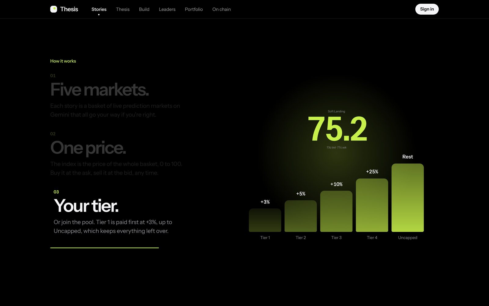

<br>

## Why correlation matters


A basket of prediction markets is a parlay, and **parlay legs aren't independent.** When Bitcoin rallies, Ether, Solana and the rest usually rally with it. Multiplying six near-coin-flip prices says "every coin closes green" is a 1.7% shot. Priced with the correlations Thesis measures, it's about **17%, ten times likelier.**

Thesis measures how each pair of markets has moved together over two weeks of hourly prices, blends that with a prior for the kind of story where markets rarely trade, and prices the basket with a **Gaussian copula**: every leg keeps its own market price, and only how often they hit *together* changes. That one number drives the odds you see, the Safe/Bold split, and the pools.

<br>

## A tour

### Live volume, front and centre

Every story shows what's actually trading. The **market pulse** counts every contract traded on Gemini in the last 24 hours, including 5-minute crypto markets and games that already settled, and the most-traded stories sit in a bento up top.

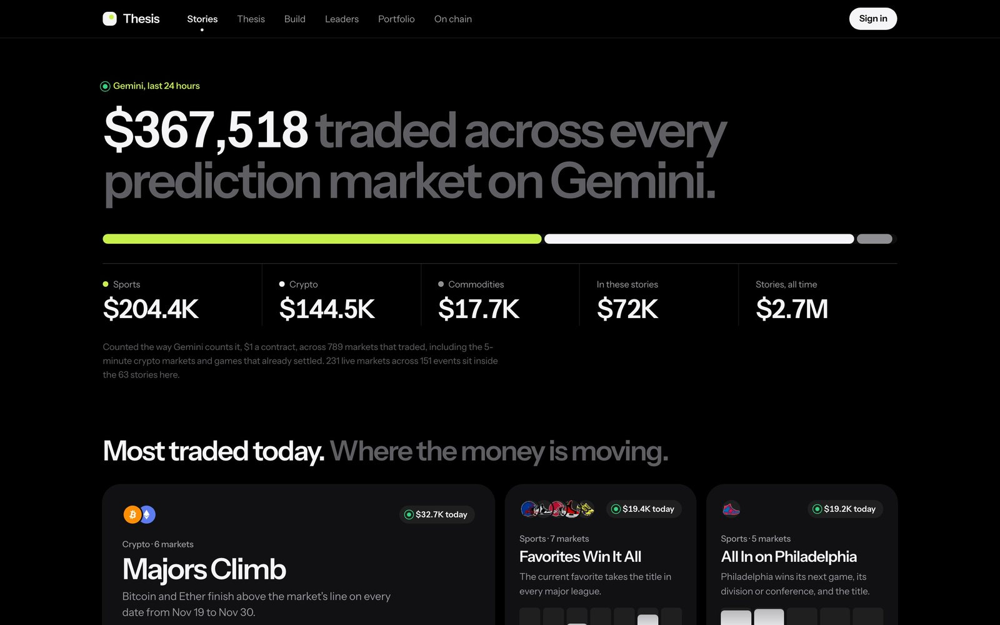

<picture>
  <source media="(prefers-color-scheme: light)" srcset="docs/media/bento-light.jpg">
  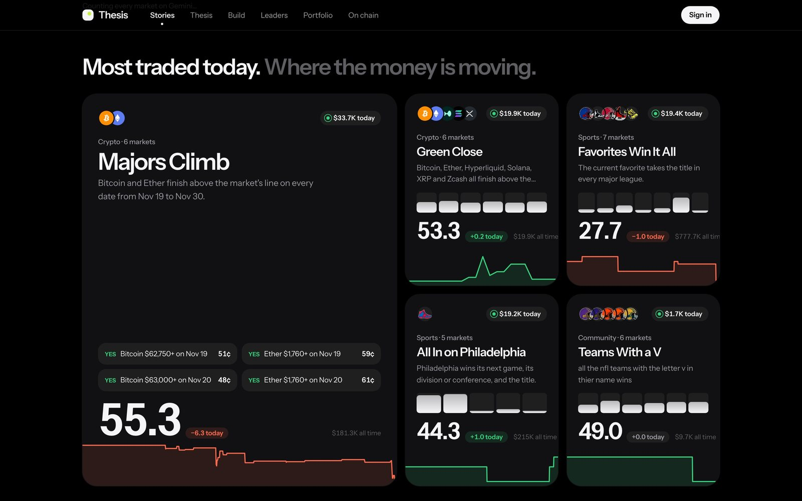
</picture>

### Tiles that tell you everything at a glance

Pictures of the markets inside, today's volume, an **odds strip** with one bar per market filled to its price, the index, today's move, and a week of prices washed across the bottom. Hover and the tile lifts, a spotlight follows your cursor and the markets fan out.

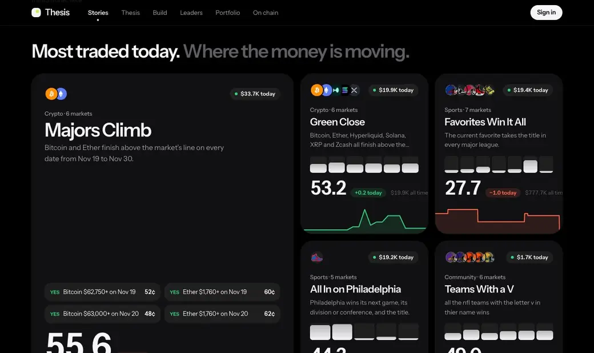

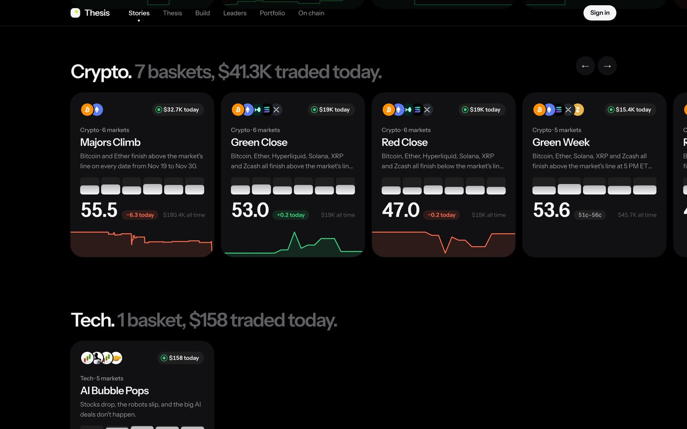

### Say what happens next

Type a view in plain words. Thesis finds the markets, picks the side of each that wins if you're right, weights them, prices the basket and explains every pick. It uses **Jev** (TypeSafe AI's decision model) or **Claude** when a key is set, exact rules for things like *"every NFL team with an L in its name wins"*, and a keyword matcher otherwise, and it always says which one picked.

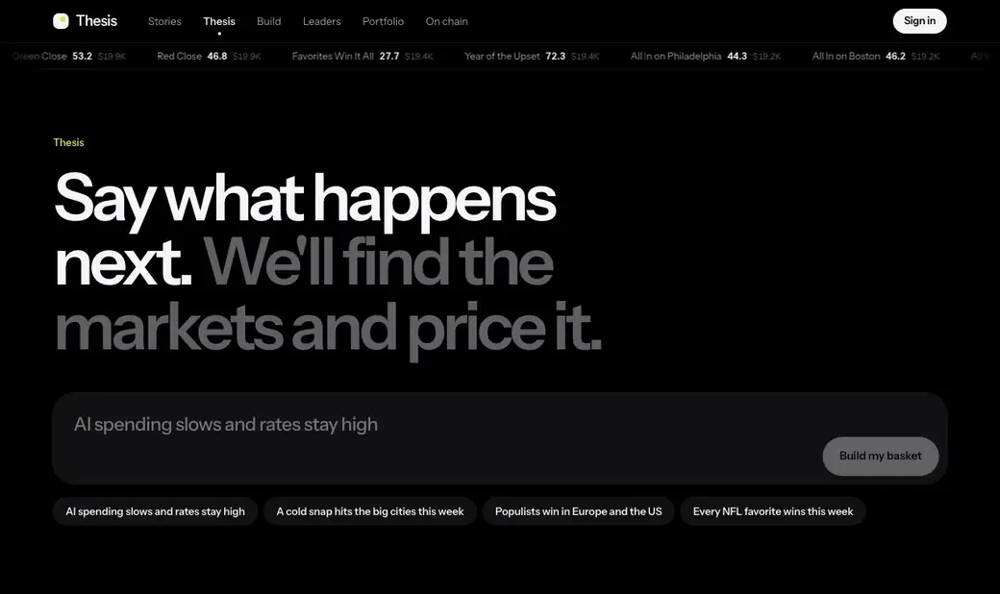

### Every story, in depth

A live index with 1-day, 1-week and 1-month charts, what moved it, volume, spread and the chance every market hits. Then every market inside with its logo, bid, ask and 24-hour volume, the buy panel, alerts, and the full distribution of how many legs will hit.

<table>
<tr>
<td width="50%">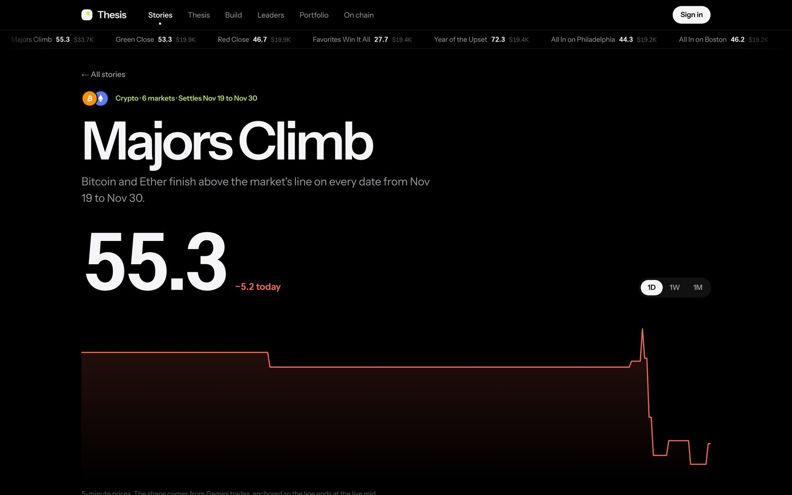</td>
<td width="50%">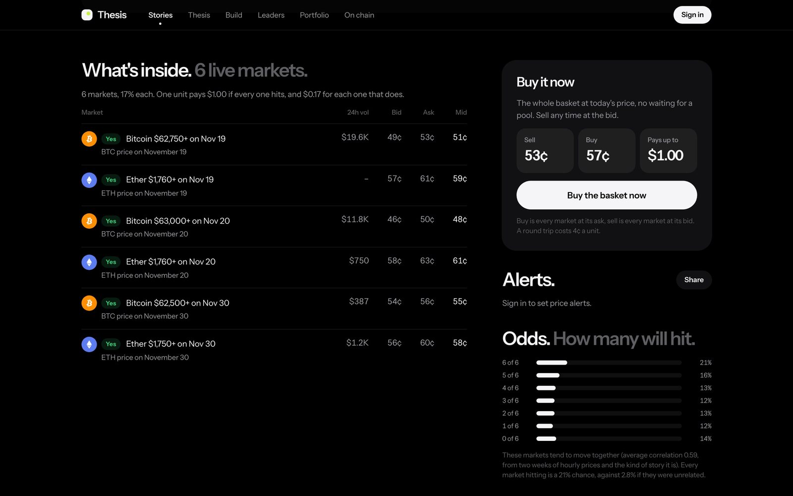</td>
</tr>
<tr>
<td width="50%">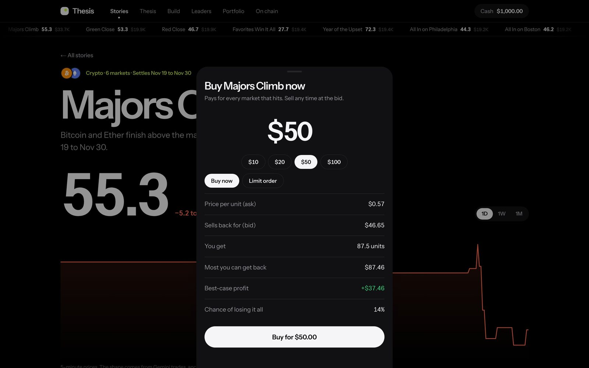</td>
<td width="50%">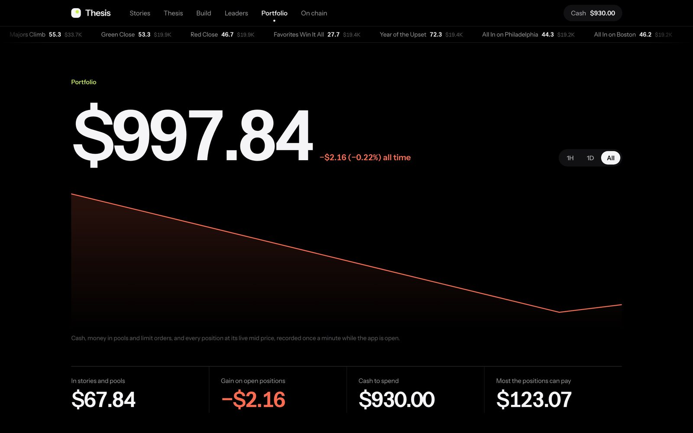</td>
</tr>
</table>

### Made for your phone too

<div align="center">
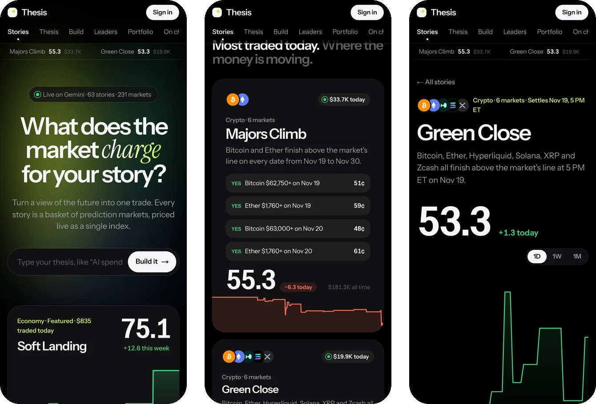
<br><br>
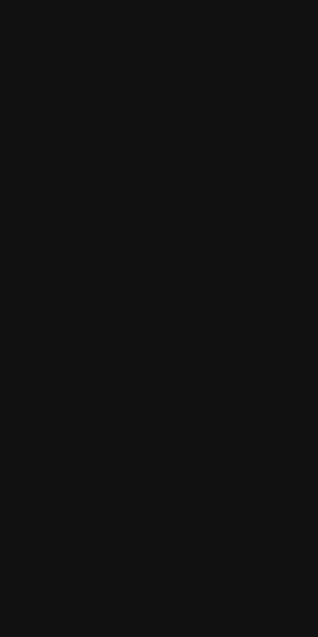
</div>

<br>

## What's inside

| | |
|---|---|
| 🧺 **Stories** | 60 to 75 baskets live at a time: economy and commodities, **crypto** (daily, weekly and month-end coin ladders that roll forward on their own), politics, team seasons, this week's games in eight leagues, and weather. Generated baskets rebuild themselves from whatever Gemini lists. |
| ✍️ **Thesis → basket** | Plain words in, a priced 5 to 8 market basket out, with a side, a weight and a reason for every leg. Jev, Claude, exact name rules or keywords, labelled every time. |
| 🛠️ **Build and publish** | Search every quotable market, pick sides and weights, watch the price update, publish. Anyone can buy it, and its creator earns 1% of every buy. |
| 📈 **Index, bid and ask** | The index is each market's weight times its mid. Buying costs every leg at its ask; selling returns every leg at its bid. Shown per market and for the basket. |
| 🪜 **Safe and Bold** | Split any basket: Safe is paid first up to a cap that's set per story so it keeps a return after the spread; Bold takes the rest. |
| 🏊 **Tiered pools** | Everyone's money buys one basket and the payout goes down a line of tiers. [How they work ↓](#tiered-pools) |
| 💵 **Live volume** | 24-hour and all-time volume on every tile, story and market, plus a count of every contract traded on Gemini today. |
| ✅ **Settlement** | When a held market resolves on Gemini it counts as $1 or $0. When every market in a position has resolved, you collect and see which ones hit. |
| 🧭 **Portfolio and risk** | Account value over time, gain per position, your biggest single exposure, exposure by theme, overlapping markets, and a story that hedges what you hold. |
| 🔔 **Alerts and limit orders** | Get told when an index crosses a level, or set cash aside to buy only if the price drops to your limit. |
| 🏆 **Leaderboards** | This week's biggest risers and fallers, community stories by return since launch, creators by fees earned. |
| 🖼️ **Share cards** | Every story link unfurls as an image with the live index and its markets. |
| 🪙 **Story tokens** | Each side (Whole, Safe, Bold) is its own SPL token on Solana devnet: a buy mints, a sell burns. |
| 🔐 **Accounts** | Email and password, saved on the server, so your practice account follows you to any device. |

<br>

## Tiered pools

Each story runs a pool. Everyone's money buys the same basket, and the payout goes **down a line**: Tier 1 (+3%) is paid first, then Tier 2 (+5%), Tier 3 (+10%) and Tier 4 (+25%), and **Uncapped** takes everything left. The page shows each tier like an options chain, with the chance of being paid in full and the likely result if you joined, both updating live as people join.

1. **It opens** with a lock time everyone can see. Games lock at the first kickoff, weather the evening before the forecast day, markets settling within a week 27 hours before the first one settles, everything else at Friday noon.
2. **People join a tier.** Move tiers freely until lock, so there's no advantage to waiting; withdraw until the last 30 minutes.
3. **It locks at a random moment in the last 30 minutes.** The random number is fixed when the pool opens and only its SHA-256 hash is shown; it's revealed at lock so anyone can check it. Deposits after the random close are refunded and moves are undone, like a candle auction.
4. **At lock, all the money buys the basket** at its ask.
5. **When every market resolves on Gemini,** the pool pays down the line and people collect.

> **Why it balances itself.** Each tier's target is fixed, but its risk depends on how much money sits ahead of it and behind it. A crowded front of the line has little cushion, so its odds fall and Uncapped's expected return rises; a crowded Uncapped makes the capped tiers safer. Every tier's odds are live, so money flows toward the better deal until people settle at the risk they actually want.
>
> **As derivatives:** a tier is a capped, senior slice of the basket's payout, like a tranche. Uncapped is a call option on the pool, struck at everything the capped tiers are owed.

<details>
<summary><b>Simulated depositors in the demo</b></summary>
<br>

So pools behave like live ones during the demo, simulated depositors join over time and are **labelled as simulated on every pool**. The money they bring is a fifth of the last day's Gemini volume across the basket's markets, between $300 and $8,000, and arrivals bunch toward the lock as real deposits do. Each picks a tier from the odds it sees at that moment: cautious ones take the best target with at least a 90% chance of being paid in full, balanced ones the best average return among tiers with at least 65%, bold ones Uncapped unless it rarely profits. Real deposits sit in the same pool and are paid by the same rules.

</details>

<br>

## Under the hood

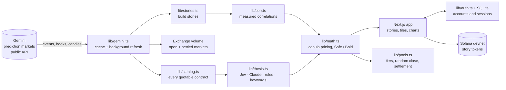

| Area | What it does |
|---|---|
| `lib/gemini.ts` | Reads Gemini's public endpoints (events by ticker and category, candles); no key. Caches in memory and refreshes in the background so a slow response never holds up a page. Counts whole-exchange volume, including settled markets fetched per category and per series, on its own request lane. |
| `lib/stories.ts` | Builds the ready-made stories: fixed baskets plus generated commodity, crypto, sports slate, team and weather ones. Crypto stories pick each coin's contract closest to 50¢ and roll to the next settle date 20 minutes before expiry. |
| `lib/math.ts` · `lib/corr.ts` | Every payout a basket can make and its chance: exact for independent legs, a deterministic Gaussian-copula simulation for correlated ones. Correlations come from two weeks of hourly moves, trusted in proportion to how often both legs traded. |
| `lib/thesis.ts` · `lib/jev.ts` | Thesis matching. Jev gets two calls (which categories and stories fit, then Yes / No / neither for up to 160 markets); Claude gets the catalog with structured output; exact rules handle team-name theses; keywords are the fallback. |
| `lib/pool-math.ts` · `lib/pools.ts` | The tier waterfall, per-tier odds, commit-and-reveal random close, locking and settlement. |
| `lib/risk.ts` | Exposure by market and theme, overlaps, and the hedge suggestion. |
| `lib/auth.ts` · `lib/db.ts` | Users, sessions and accounts in SQLite (built into Node). scrypt password hashes, 30-day httpOnly cookies with only their hash stored, login rate limits, versioned account saves. |
| `lib/solana.ts` · `lib/chain-client.ts` | Mint and burn SPL story tokens on devnet; the treasury pays every fee so users never need SOL. |

<details>
<summary><b>On chain</b></summary>
<br>

- **Cluster:** Solana devnet. **Program:** the standard SPL Token program, `TokenkegQfeZyiNwAJbNbGKPFXCWuBvf9Ss623VQ5DA`. No custom program.
- **Treasury:** one key that's mint authority for every story token and pays every fee. A sell is a burn signed by the user's wallet with the treasury as fee payer.
- **Mints** are created the first time each story side is bought. The `/chain` page lists the treasury, its balance and every mint with explorer links.
- **Funding:** the devnet RPC faucet is closed, so send devnet SOL to the treasury address on `/chain` from faucet.solana.com. Until then, buys still work and say they weren't minted.
- The treasury key comes from `SOLANA_TREASURY_SECRET` (a JSON byte array) or is created in `.data/solana-treasury.json`, which is never committed.

</details>

<details>
<summary><b>Project layout</b></summary>
<br>

```
app/
  page.tsx               home: hero, how it works, pulse, most traded, shelves
  s/[id]/                story page and its share image
  thesis/  build/        thesis to basket, and the story builder
  portfolio/  leaders/   your account, and the leaderboards
  chain/  signin/        story tokens, and accounts
  api/                   stories, history, marks, volume, thesis, pools,
                         community, chain, auth, account, health
components/              tiles, shelves, charts, buy sheet, pool panel, scroll scenes
lib/                     data, pricing, stories, thesis, pools, risk, auth, chain
tests/                   pricing, pools, risk, mood and password tests
docs/media/              everything in this README
Dockerfile               one container, SQLite on a /data volume
```

</details>

<br>

## Run it

```bash
npm install
npm run dev
```

Open http://localhost:3000, create an account, and you get $1,000 of practice money.

```bash
npm test
```

31 tests check the pricing against brute-force enumeration and closed-form answers, the pool waterfall against worked examples, the random close, the risk maths, the mood reader and password hashing.

### Environment

All optional. Market data needs no key.

| Variable | For |
|---|---|
| `AIMLAPI_KEY` | Jev thesis matching through AI/ML API (`TYPESAFE_API_KEY` for TypeSafe's own endpoint; `JEV_URL`, `JEV_MODEL` to override) |
| `ANTHROPIC_API_KEY` | Claude thesis matching |
| `SOLANA_TREASURY_SECRET`, `SOLANA_RPC_URL` | Devnet story tokens |
| `DATA_DIR` | Where the database and data files live (default `.data/`) |

### Deploy

Thesis is one Node server plus a SQLite file, so it wants a host with a long-lived container and a persistent disk: **Railway, Fly.io, Render** or any VPS. Serverless hosts like Vercel don't keep a disk, so accounts would be lost.

```bash
docker build -t thesis .
docker run -p 3000:3000 -v thesis-data:/data thesis
```

On a host: deploy the Dockerfile, mount a volume at `/data`, and serve over HTTPS (session cookies are `Secure` in production). The image has a health check at `/api/health`. Back up `/data/thesis.db`.

<br>

## Where it stands

| Part | State |
|---|---|
| Market data, index, bid and ask, charts, volume | ✅ Live from Gemini's public API |
| Settlement | ✅ Resolved Gemini contracts pay $1 or $0 |
| Thesis to basket | ✅ Jev or Claude with a key; exact rules and keywords without |
| Community stories and creator fees | ✅ Working, stored on the server |
| Tiered pools | ✅ Working with practice money, plus labelled simulated depositors · 🔜 Solana vault to hold real money |
| Accounts | ✅ Email and password, saved on the server · 🔜 password reset and email verification |
| Buy, sell, limit orders, alerts | ✅ Practice money · 🔜 trades executed and re-priced on the server |
| Story tokens | ✅ Built on Solana devnet, on once the treasury has devnet SOL |
| Orders on Gemini | 🔜 Not built: buys don't place Gemini orders yet |

<details>
<summary><b>Assumptions and risks</b></summary>
<br>

- **Fixed targets.** A tier's target doesn't adjust to its risk. A crowded or badly placed tier can lose money on average even when paid early; its chance of being paid in full falls when that happens, which is the signal to move.
- **Locked money.** Pool money can't leave between lock and settlement. Game and weather pools settle within days; weekly pools on long stories can hold money for weeks.
- **Trust.** In the intended design the app holds the Gemini positions and the story token is a receipt for a share of them. Today the tokens are receipts for practice-money positions.
- **Correlation.** Measured correlations on thin markets are noisy, so they're blended with a prior. The copula captures how often legs hit together, not every shape of dependence.
- **Thin markets.** With no two-sided quote, a contract's mid is the last trade or the one quoted side, the missing side is estimated 5¢ away, and it's marked with an asterisk.
- **History.** Chart shapes come from traded prices, each market's line shifted to end at its live mid. Contracts that never trade are recorded once a minute while the server runs.
- **Matching.** Without a Jev or Anthropic key, the thesis matcher only matches words (plus exact NFL name rules). Review before publishing.
- **Trades are trusted from the browser.** The server checks every account is well formed and never below zero cash, but doesn't re-price each trade. Fine for practice money; buys and sells should move to the server before real money or a user leaderboard.
- **Storage.** Everything lives in `DATA_DIR`, which must be on a persistent disk in production.

</details>

<br>

## Stack

Next.js 16 (App Router, TypeScript) · SQLite via `node:sqlite` · Gemini Prediction Markets API · Jev (TypeSafe AI) and the Anthropic TypeScript SDK · `@solana/web3.js` and `@solana/spl-token` · Zod · Vaul · Sonner · hand-written CSS and SVG charts, no UI kit.

<div align="center">
<br>
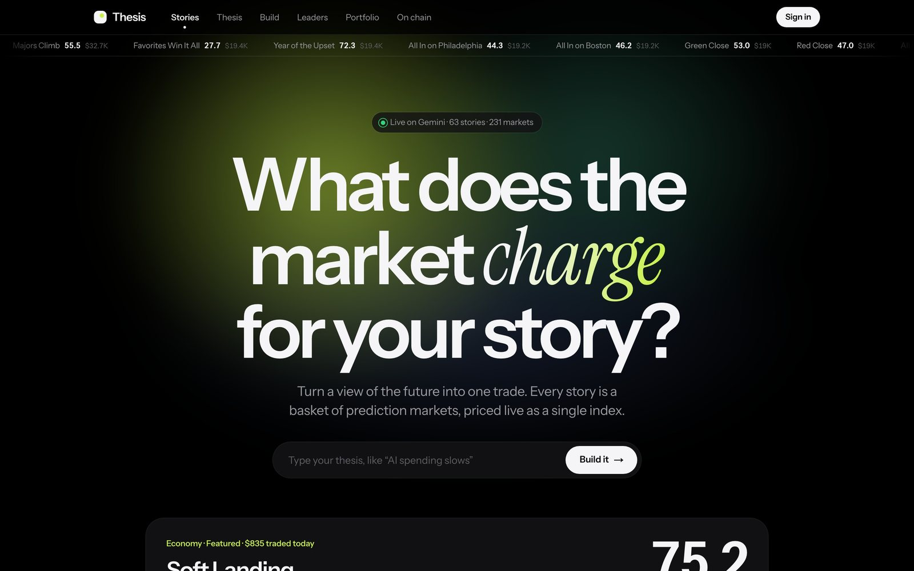
<br><br>
<sub>Practice money only. Thesis is a hackathon demo and doesn't take deposits.</sub>
</div>
